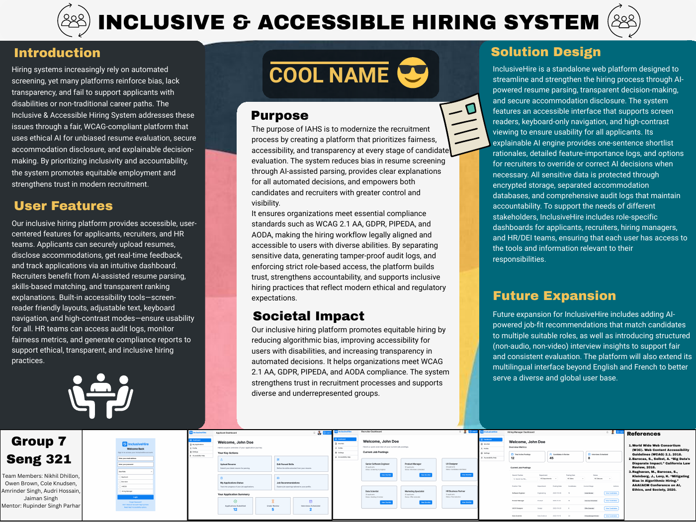

# InclusiveHire

A requirements and solution-design project for an accessible hiring platform with explainable screening and accommodation workflows.

**Design portfolio · SENG 321 · University of Victoria · Fall 2025**

## View the project

- [Requirements specification, RSD 3.1](docs/Requirements_Specification_RSD3.1.pdf): the full 72-page team document, dated November 22, 2025.
- [Project poster](docs/InclusiveHire_Poster.pdf): a visual overview of the proposed system.
- [Contribution and document guide](CONTRIBUTIONS.md): where to find the relevant sections and authorship evidence.

This repository documents a proposed system; application source code and a deployed service are not included.

## Proposed workflows

- Applicants upload resumes, disclose accommodations and track applications.
- Recruiters review skills-based matches, shortlist explanations and override options.
- Hiring managers and HR/DEI teams use role-specific dashboards and audit information.

The design calls for screen-reader support, keyboard navigation, high-contrast viewing, separated accommodation storage and role-based access. These are design requirements, not independently validated accessibility, security or legal-compliance certifications.

## My contribution

Amrinder Singh authored and revised Section 4 (External Interface Requirements), including requirements and rationales for user, hardware, software and communications interfaces. The revision history also credits him with helping the foreign-key dictionary and adding the user story and mockups for Section 3.5 (Accessibility and Compliance).

The project poster and requirements specification are team artifacts. The use-case diagram in Section 4.1 is credited to Jaiman Singh in the revision history. A client presentation mentioned in the resume is not included here.

## Deliverable and next steps

The included requirements specification covers functional and non-functional requirements, use cases, sequence and data-flow diagrams, interface requirements, an ER diagram and a data dictionary. The poster summarizes the proposed system. Next steps would be a testable prototype, accessibility evaluation and validation of screening explanations and human overrides. Claims about fairness would require evidence from such evaluation.

## Team and source

Group 7: Nikhil Dhillon, Owen Brown, Cole Knudsen, Amrinder Singh, Audri Hossain and Jaiman Singh. Mentor: Rupinder Singh Parhar. The original team poster is preserved in `docs/`, including its references.
